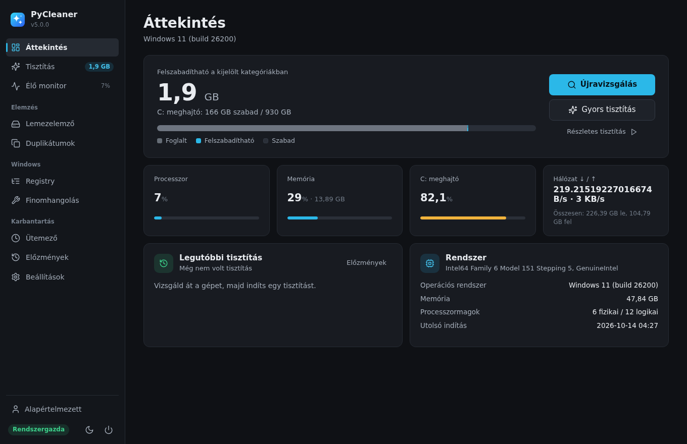
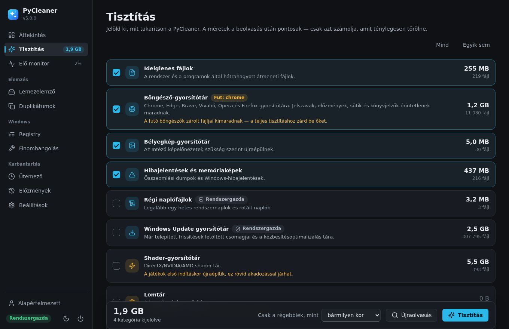
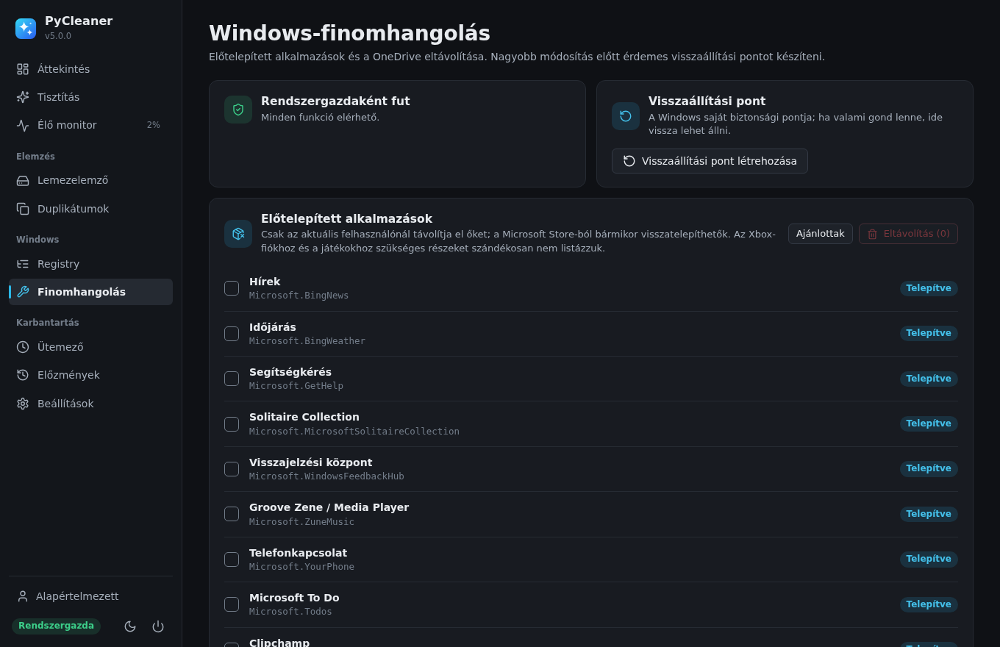

<p align="center">
  
</p>

<h1 align="center">PyCleaner</h1>

<p align="center">
  <b>Rendszertisztító és karbantartó Windowsra — natív ablakkal, magyarul, biztonságos alapbeállításokkal.</b><br>
  <a href="https://github.com/csiber/pycleaner/releases/latest"></a>
  <a href="https://github.com/csiber/pycleaner/actions/workflows/ci.yml"></a>
  
  <a href="LICENSE"></a>
</p>

<p align="center"></p>

## Letöltés

A [legújabb kiadásnál](https://github.com/csiber/pycleaner/releases/latest) két változat közül választhatsz:

| Fájl | Mikor ezt? |
|---|---|
| **`PyCleaner-<verzió>-Setup.exe`** | Ajánlott. Telepít a Start menübe, eltávolítható a Beállítások → Alkalmazások alól. Rendszergazdai jog nem kell hozzá. |
| `PyCleaner-<verzió>-portable.exe` | Egyetlen fájl, telepítés nélkül — pendrive-ra, szervizeléshez. |
| `PyCleaner-<verzió>-win64.zip` | Kicsomagolható mappás változat (gyorsabb indulás, mint a hordozható). |

A `SHA256SUMS.txt` fájllal ellenőrizheted a letöltés épségét. Követelmény: Windows 10 vagy 11 (64 bites). A natív ablakhoz a Windowsba épített **WebView2** kell; ha hiányzik, a program automatikusan a böngészőben nyílik meg.

## Mit tud?

| | |
|---|---|
| 🧹 **Tisztítás** | Ideiglenes fájlok, böngésző-gyorsítótár (Chrome, Edge, Brave, Vivaldi, Opera, Firefox — minden profil), bélyegképek, hibajelentések és memóriaképek, régi naplók, Windows Update gyorsítótár, shader-tár, Lomtár, saját mappák |
| 📡 **Élő monitor** | CPU- és memóriagrafikon, lapozófájl, lemez, hálózati sebesség, a legtöbb memóriát használó folyamatok |
| 💽 **Lemezelemző** | Meghajtók, személyes mappák mérete, a legnagyobb fájlok — egy kattintással megmutatja őket az Intézőben |
| 👥 **Duplikátumok** | Tartalom alapján (méret → első 64 KB → BLAKE2b), „mindenhol a legújabb marad” kijelöléssel |
| 🗝️ **Registry** | Óvatos keresés: árva eltávolító-bejegyzések, nem létező programra mutató indítási elemek, MUI-gyorsítótár — javítás előtt automatikus `.reg` mentés |
| 🛠️ **Finomhangolás** | Előtelepített alkalmazások (Candy Crush, Clipchamp, Cortana…) és a OneDrive eltávolítása, visszaállítási pont, újraindítás rendszergazdaként |
| ⏰ **Ütemező** | Automatikus háttértisztítás, amíg a program fut |
| 📊 **Előzmények** | Minden tisztítás naplója, HTML-riport és JSON-export, törlés előtti ZIP-mentések |
| 🎨 **Megjelenés** | Világos / sötét / rendszertéma, hat kiemelőszín, profilok (pl. saját és családi gép) |

<p align="center">
  
  
</p>

## Biztonság — mit **nem** csinál

- **Nem nyúl a személyes adatokhoz.** A böngészőknél csak a gyorsítótár törlődik; jelszó, előzmény, süti, könyvjelző marad.
- **Nem követ szimbolikus linket és junctiont**, és nem üríti a meghajtó gyökerét, a Windows, Program Files, felhasználói profil, Asztal, Dokumentumok, Letöltések mappát — akkor sem, ha valaki egyéni mappaként adná meg.
- **A fájlkereső találatai a Lomtárba kerülnek**, nem véglegesen törlődnek. Csak olyan fájl törölhető, amit a program maga listázott ki.
- **Registry-módosítás előtt mindig van mentés**; ha a mentés nem sikerül, nem módosít.
- **Nem telepít semmit és nem küld adatot.** Egyetlen hálózati kérés a frissítés-ellenőrzés (a GitHubon közzétett verziószám lekérése), ez kikapcsolható.
- A felület egy csak a gépen elérhető (`127.0.0.1`) szerverről jön, futásonként egyedi tokennel és Host-ellenőrzéssel, így más weboldal nem tudja távolról vezérelni.

Részletek: [wiki → Biztonság](https://github.com/csiber/pycleaner/wiki/Biztonság) · Biztonsági hibát a [SECURITY.md](SECURITY.md) szerint jelezz.

## Kódaláírás

Free code signing provided by [SignPath.io](https://about.signpath.io), certificate by [SignPath Foundation](https://signpath.org).
A Windows-fájlokat a GitHub Actions építi és írja alá közvetlenül ebből a tárolóból — részletek: [kódaláírási szabályzat](CODESIGNING.md).
*Állapot: a SignPath Foundation-jelentkezés folyamatban; addig a kiadások aláíratlanok, ezért a SmartScreen „Ismeretlen kiadó” figyelmeztetést adhat („További információ” → „Futtatás mindenképp”).*

## Futtatás forrásból

```bash
git clone https://github.com/csiber/pycleaner.git
cd pycleaner
python -m venv .venv
.venv\Scripts\activate            # Linux/macOS: source .venv/bin/activate
pip install -r requirements.txt
python main.py                    # natív ablak; --browser: böngészőben, --no-open: csak a szerver
```

Python 3.10 vagy újabb kell. Linuxon és macOS-en az alapfunkciók (tisztítás, monitor, lemezelemző, duplikátumok) működnek, a Registry és a Finomhangolás csak Windowson jelenik meg.

### Windows-build

```powershell
powershell -ExecutionPolicy Bypass -File packaging\build.ps1
```

Lefuttatja a teszteket, majd elkészíti a `dist\PyCleaner\` mappát, a `dist\PyCleaner-portable.exe`-t és — ha telepítve van az [Inno Setup 6](https://jrsoftware.org/isinfo.php) — a telepítőt. Kiadás: a `pycleaner/__init__.py` verziójának emelése, CHANGELOG-bejegyzés, majd egy `v<verzió>` címke felküldése; a többit a [Windows-kiadás](.github/workflows/release.yml) workflow intézi.

## Adatok helye

Beállítások, előzmények, mentések és napló: `%LOCALAPPDATA%\PyCleaner`. Hordozható módhoz tegyél egy üres `portable.txt` fájlt az exe mellé — ekkor az adatok a `PyCleanerData` mappába kerülnek mellette. Felülírható a `PYCLEANER_DATA` környezeti változóval is.

## Állapot

**5.0.0 — 2026-10-18:** teljes újraírás (lásd [CHANGELOG](CHANGELOG.md)). Tesztelve Windows 11 (26200) és Linux alatt; a CI Windows és Ubuntu alatt, Python 3.10 és 3.13 verzióval futtatja a teszteket.

Nyitott tételek:

- [ ] Kódaláírás — a workflow kész rá (`.signpath/`), a SignPath Foundation jóváhagyására vár
- [ ] Az ütemező Windows Feladatütemezőbe kötése, hogy zárt programmal is fusson
- [ ] Indítópult-kezelő (automatikusan induló programok ki/be kapcsolása)
- [ ] Angol nyelvű felület

## Licenc

[MIT](LICENSE) © Polyák Csaba. Az ikonok a [Lucide](https://lucide.dev) készletből származnak (ISC).
